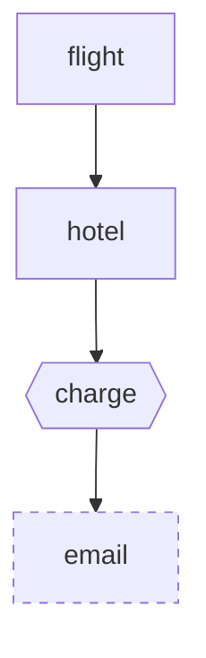

# sagas

A business operation often changes several services, such as an airline, a hotel and a bank, and no single transaction covers them all. This Go library runs such an operation as a saga: either every step completes, or the library undoes the part that ran.

[](https://pkg.go.dev/github.com/rilder-almeida/sagas)

## Install

The library needs Go 1.27 or later. The core package imports only the standard library.

```sh
go get github.com/rilder-almeida/sagas
```

## Quick start

This program books two trips. Each trip has four steps: a flight, a hotel, a charge on the card and an email. A step is a type that embeds `sagas.Step`. Its methods are its behavior:

- `Execute` is the action, the work that the step does.
- `Compensate` is the compensation. It undoes the action in business terms.
- `Pivot` marks the pivot, the step at the point of no return. After the pivot succeeds, the saga only moves forward.

Each step calls a `service`, a small in-memory stand-in for the airline, the hotels, the bank and the mail. The step sends `sagas.IdempotencyKey(ctx)` with each call. This idempotency key is the same on each call of the step and on the call of its compensation. The service books once for each key. It refuses a key that it already canceled. It answers "not found" to a cancel of a key that it never booked.

The [glossary](docs/glossary.md) defines every term of the library. Put this code in `main.go` of a new module:

```go
package main

import (
	"context"
	"errors"
	"fmt"
	"log"
	"sync"

	"github.com/rilder-almeida/sagas"
)

var (
	errNoRooms  = errors.New("no rooms")
	errNotFound = errors.New("no booking for this key")
	errCanceled = errors.New("booking key already canceled")
)

type service struct {
	mu       sync.Mutex
	full     map[string]bool
	booked   map[string]bool
	canceled map[string]bool
}

func newService(full ...string) *service {
	s := &service{full: map[string]bool{}, booked: map[string]bool{}, canceled: map[string]bool{}}
	for _, city := range full {
		s.full[city] = true
	}

	return s
}

func (s *service) Book(ctx context.Context, key, city string) error {
	if err := ctx.Err(); err != nil {
		return err
	}

	s.mu.Lock()
	defer s.mu.Unlock()

	switch {
	case s.canceled[key]:
		return fmt.Errorf("%w: %s", errCanceled, key)
	case s.full[city]:
		return fmt.Errorf("%w in %s", errNoRooms, city)
	}

	s.booked[key] = true

	return nil
}

func (s *service) Cancel(ctx context.Context, key string) error {
	if err := ctx.Err(); err != nil {
		return err
	}

	s.mu.Lock()
	defer s.mu.Unlock()

	s.canceled[key] = true
	if !s.booked[key] {
		return fmt.Errorf("%w: %s", errNotFound, key)
	}

	delete(s.booked, key)

	return nil
}

type trip struct {
	ID   string
	City string
}

func (t *trip) ExecutionID() string { return t.ID }

type flight struct {
	sagas.Step

	airline *service
}

func (f *flight) Execute(ctx context.Context, t *trip) error {
	return f.airline.Book(ctx, sagas.IdempotencyKey(ctx), t.City)
}

func (f *flight) Compensate(ctx context.Context, _ *trip) error {
	err := f.airline.Cancel(ctx, sagas.IdempotencyKey(ctx))
	if errors.Is(err, errNotFound) {
		return nil
	}

	return err
}

type hotel struct {
	sagas.Step

	hotels *service
}

func (h *hotel) Execute(ctx context.Context, t *trip) error {
	err := h.hotels.Book(ctx, sagas.IdempotencyKey(ctx), t.City)
	if errors.Is(err, errNoRooms) {
		return sagas.Permanent(err)
	}

	return err
}

func (h *hotel) Compensate(ctx context.Context, _ *trip) error {
	err := h.hotels.Cancel(ctx, sagas.IdempotencyKey(ctx))
	if errors.Is(err, errNotFound) {
		return nil
	}

	return err
}

type charge struct {
	sagas.Step

	bank *service
}

func (c *charge) Pivot(ctx context.Context, t *trip) error {
	return c.bank.Book(ctx, sagas.IdempotencyKey(ctx), t.City)
}

type email struct {
	sagas.Step

	mail *service
}

func (e *email) Execute(ctx context.Context, t *trip) error {
	return e.mail.Book(ctx, sagas.IdempotencyKey(ctx), t.City)
}

func main() {
	if err := run(); err != nil {
		log.Fatal(err)
	}
}

func run() error {
	flow := sagas.Sequence(
		&flight{airline: newService()},
		&hotel{hotels: newService("Porto")},
		&charge{bank: newService()},
		&email{mail: newService()},
	)

	saga, err := sagas.New[trip]("trip", flow)
	if err != nil {
		return err
	}

	for _, t := range []*trip{{ID: "trip-42", City: "Lisbon"}, {ID: "trip-43", City: "Porto"}} {
		if reportErr := report(t.ID, saga.Run(context.Background(), t)); reportErr != nil {
			return reportErr
		}
	}

	return nil
}

func report(id string, runErr error) error {
	var failed *sagas.RunError

	switch {
	case runErr == nil:
		_, err := fmt.Printf("%s: completed\n", id)

		return err
	case errors.As(runErr, &failed):
		_, err := fmt.Printf("%s: %s, pending: %v\n", id, failed.Kind.Name(), failed.Pending)

		return err
	default:
		return runErr
	}
}
```

Run it:

```sh
go run .
```

The program prints this output:

```text
trip-42: completed
trip-43: compensated, pending: []
```

The hotel in Porto has no rooms, so the second trip fails at the hotel step. The hotel step wraps that error in `sagas.Permanent`. A [permanent error](docs/glossary.md) stops the retries at once, so the library does not ask again for a room in a full city. The library then runs the compensations of the hotel and the flight. The airline cancels the flight. The hotels never booked the key and answer "not found", and the hotel compensation treats that answer as success. The run ends compensated. No step is pending, so nobody has to finish anything by hand.

`sagas.Sequence` puts the steps in order and returns a `Flow`. `sagas.New` checks the flow and returns a saga that you run many times. An execution is one run of the saga over one state value. The `ExecutionID` method gives each execution a business name, so a repeated request keeps its name. `Run` returns nil for a completed run and a `*sagas.RunError` for any other end of a run that began. An error that stops the run before it begins, such as `ErrInvalidRun`, returns as it is.

The full trip program in [`examples/trip`](examples/trip) calls simulated services for the airline, the hotels, the payments and the mail. Run it with `go run ./examples/trip`. The [tutorial](docs/tutorial/book-a-trip.md) builds that program step by step.

## The guarantees

A saga is not a database transaction. No lock holds the steps together, and other readers see the effect of each step as soon as it ends. The library makes smaller promises instead.

### All or nothing, up to the pivot

When a run ends, either every step is done or the library undoes the part that ran. The library compensates every started step that has a compensation, also a step whose call failed or timed out. Such a call can still change something outside. Before it compensates, the library stops the running steps and waits for them. The compensations then run in the reverse order of the flow. Steps that ran in parallel compensate in parallel.

### The pivot

You cannot undo some steps, such as a payment that left the bank. The pivot is such a step. Its call applies whole or not at all. An unknown outcome means that a call timed out, stopped on a cancel or panicked, so nobody knows whether its effect happened. The pivot splits the saga into two zones:

- The compensable zone holds the steps before the pivot. A failure or an unknown outcome there undoes them.
- The forward-only zone holds the steps after the pivot. A failure or an unknown outcome there never undoes anything.

A failed pivot did not apply, so the library undoes the compensable zone. The library retries an unknown pivot with the same key and never undoes it. When the attempts run out, the run ends `ErrIncomplete`, and a person must finish the run. The pivot is then pending. A saga with no pivot has only the compensable zone. `New` rejects a flow that breaks a pivot rule, so the error comes before the first run.

### At least once

The library calls each action and each compensation at least once, and sometimes twice. A retry after a timeout repeats a call, for example. The library cannot know whether the first call changed anything outside.

The journal is the append-only record of what an execution intends and did. The library writes the intent of each call to the journal before the call runs. If the journal cannot write, the call does not run.

### The run contract

These rules describe how a run ends. The [guarantees page](docs/explanation/guarantees.md) explains each rule and the reason behind it.

- Each step has a retry policy, `Step.Retry`. The default is three attempts with jitter, a random change to each delay. The same policy governs the compensation of the step. Under `sagas.NoRetry()`, the compensation also gets one attempt. For a more persistent compensation, raise `Retry.Attempts`.
- The caller's context bounds the recovery. Recovery is the work that follows a failure, an unknown outcome, a cancel or a failed journal write. When the caller's context ends, the grace period starts. The grace period is the time that recovery gets after that end. `sagas.WithRecoveryTimeout(d)`, passed to `New`, sets its length. The default is five minutes.
- A call that returns after the grace period ends can miss the journal. It still shows in the error of `Run`.
- `RunError.Steps` holds one `*sagas.Error` for each action or compensation that did not succeed, in order. One step can appear twice: once for its action and once for its compensation.
- `RunError.Pending` lists the steps that a person must still finish, undo or look into. The journal is the durable source. `Pending` can owe more than the journal, never less. One case departs from this, and here the journal owes more. After a failed journal write, the library sends the same event again. This resend can record the intent of a step that never ran. The library then writes a failure for that step. If that write fails too, the journal lists the step as unknown. If the step has a compensation, the journal also lists it as pending, so a later compensation runs on nothing. The first compensation case below covers it.
- After `ErrConcurrentWriter`, another `Run` call owns the execution. `Pending` then informs you, and it is not a list of work to do.
- A step's own error can carry `context.Canceled`. To learn whether your caller canceled, test your own `ctx.Err()` or `errors.Is(err, sagas.ErrGraceEnded)`.
- `context.Canceled` is one value. The library cannot tell a journal's own internal cancel apart from the end of the grace period.
- `Step.CompensationFailure` sets the policy for a failed compensation. `CompensationBlock`, the default, stops each compensation that waits on the failed one. `CompensationHalt` stops every remaining compensation. `CompensationContinue` goes on with the rest. It can leave an earlier step undone while a later step stays done, a departure from the original 1987 saga paper (see [Papers](#papers)). Each policy ends the run `ErrCompensationFailed`, and a person finishes the undo of the failed step. With `CompensationBlock` and `CompensationHalt`, the person also runs the compensations that the policy stopped.

## Your part of the contract

The library asks three things of each step that you write.

### Honor the context and be idempotent

Every action and every compensation honors its context and is idempotent. An idempotent call that runs twice has the same effect as a call that runs once. In a step method, `sagas.IdempotencyKey(ctx)` returns the idempotency key: the execution ID, a slash and the step name. The key is the same on every attempt and on the compensation. Send it to the outside service, so that the service can recognize a repeat. This step of [`examples/trip`](examples/trip/trip.go) does that:

```go
func (c *charge) Pivot(ctx context.Context, t *trip) error {
	id, err := c.payments.Charge(ctx, sagas.IdempotencyKey(ctx), t.Amount)
	if err != nil {
		return err
	}

	t.ChargeID = id

	return nil
}
```

The key holds the execution ID. If the state has an `ExecutionID() string` method, the ID comes from it. Otherwise the library draws a random ID, and a repeated request looks like a new execution.

### Handle the three compensation cases

Each compensation must be correct in three cases. Each case can happen in production.

1. The action never applied. The call failed or timed out before it changed anything. The compensation does nothing and returns nil. If the outside service answers "not found", the compensation treats that answer as success.
2. The compensation runs twice. The second run has the same effect as the first.
3. The action lands late, after its compensation. Usually the service refuses an action whose key it already canceled.

The [`sagastest`](https://pkg.go.dev/github.com/rilder-almeida/sagas/sagastest) package injects each case into your own saga. The how-to guide [How to test a saga](docs/how-to/test-a-saga.md) shows the steps.

### Keep the state plain

All steps share one state value. The library copies it for each attempt, and it commits the changes of a successful attempt at once. It copies the state through its JSON encoding, so the state is a closed set of plain types. A state is a struct, and its fields can be:

- `bool`, integers other than `uintptr`, `float32`, `float64` and `string`
- structs with exported fields, with no embedded field and no tag
- arrays and slices
- maps with `string` or integer keys
- pointers that do not point at a pointer, a slice or a map

No type defines its own encoding, and `time.Duration` and `jsontext.Value` are not allowed either. Store a time as an `int64` of Unix nanoseconds or as an RFC 3339 `string`. Store a duration as an `int64` of nanoseconds.

`New` rejects a state type that breaks a rule, and the error names the field and the rule. Two more facts follow from the copy:

- Two pointers to one object become two objects.
- A value that the encoding cannot handle fails the commit with `ErrInvalidState`. Examples are NaN, positive or negative infinity, a pointer cycle and a `string` with invalid UTF-8.

## The flow as a diagram

`Mermaid()` draws a saga as a flowchart in [Mermaid](https://mermaid.js.org), a text format for diagrams that GitHub renders. The pivot is a hexagon, and a dashed border marks the forward-only zone. This is the output for the trip saga:



## Documentation

- [Tutorial: book a trip with a saga](docs/tutorial/book-a-trip.md) builds the trip program and breaks it on purpose.
- [How to test a saga](docs/how-to/test-a-saga.md) runs the `sagastest` helpers on your own saga.
- [Middleware recipes and run settings](docs/how-to/middleware-recipes.md) add limits, a circuit breaker, error classification and deadlines.
- [The guarantees of a saga](docs/explanation/guarantees.md) explains what the library promises and why.
- [Design decisions](docs/explanation/design-decisions.md) gives the reason behind each choice in the API.
- [Glossary](docs/glossary.md) defines each term and names the code that carries it.
- [Changelog](CHANGELOG.md) lists the changes of each release.
- The API reference is on [pkg.go.dev](https://pkg.go.dev/github.com/rilder-almeida/sagas), with the [`sagastest`](https://pkg.go.dev/github.com/rilder-almeida/sagas/sagastest) package.

## Papers

The design follows these papers and articles. Read them at their source:

- Garcia-Molina and Salem, ["Sagas"](https://www.cs.cornell.edu/andru/cs711/2002fa/reading/sagas.pdf) (1987), introduce the saga and its compensations.
- McCaffrey, Kingsbury and Narula, ["Distributed sagas"](https://github.com/aphyr/dist-sagas/blob/master/sagas.pdf) (2016), treat the unknown outcome of a call as a normal case.
- Sookocheff, ["Fault tolerance and data consistency using distributed sagas"](https://sookocheff.com/post/architecture/fault-tolerance-and-data-consistency-using-distributed-sagas/) (2018), describes the pattern for services.
- Mehrotra, Rastogi, Silberschatz and Korth, ["A transaction model for multidatabase systems"](https://doi.org/10.1109/ICDCS.1992.235055) (1992), give the terms compensatable, retriable and pivot.

## License

See [LICENSE.txt](LICENSE.txt).
